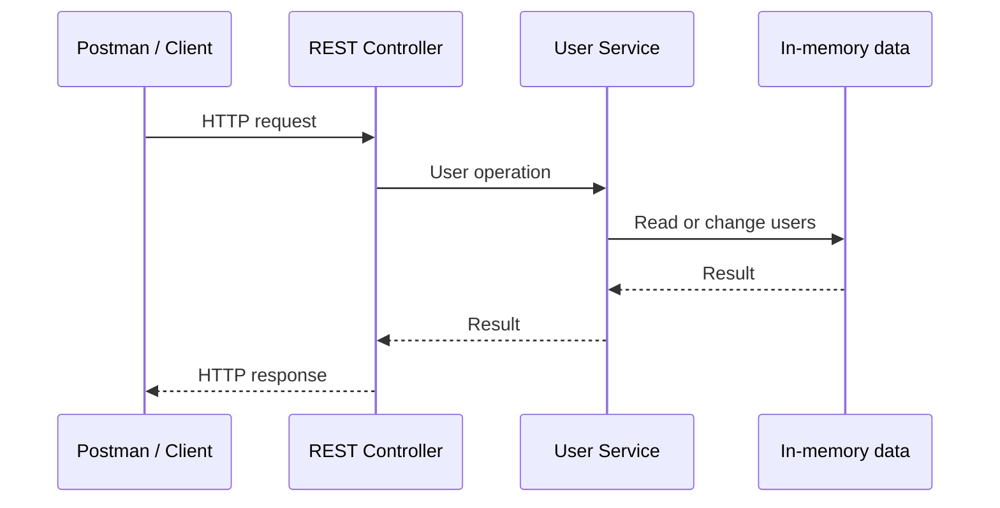

# Section 4: Building a User Management API

Is section mein hum ek chhoti User Management REST API ko samjhenge aur step by step banayenge. Ek hi Section 4 document mein course roadmap, lesson notes, implementation decisions aur revision points rakhe jayenge; har topic ke liye alag Markdown file nahi banegi.

## Section roadmap

| Lesson | Topic | Duration | Course status |
|---|---|---:|---|
| Play30 | Download and Setup Postman Collection for This Course | 2 min | Completed |
| Play31 | Understanding the Project We Are Going to Build | 3 min | Completed |
| Play32 | NEW — Spring Boot 4 Update | 1 min | Completed |
| Play33 | Setting up a New Spring Boot Project | 7 min | Completed |
| Play34 | Structuring Thoughts Before Moving Forward | 2 min | Completed |
| Play35 | Fetching All Users | 3 min | Completed |
| Play36 | Adding New Users | 9 min | Not completed |
| Play37 | Setting up User Service | 10 min | Not completed |
| Play38 | Challenge: Managing IDs | 7 min | Not completed |
| Play39 | Getting Single User | 9 min | Not completed |
| Play40 | ResponseEntity Class | 10 min | Not completed |
| Play41 | Making use of Java Streams | 4 min | Not completed |
| Play42 | Challenge: Update User Endpoint | 11 min | Not completed |
| Play43 | @RequestMapping Annotation | 7 min | Not completed |

Course status upar user-provided lesson progress ko reflect karta hai; neeche ke notes aur workspace implementation alag se review/approve honge.

## Play30 — Download and Setup Postman Collection

**Course duration:** 2 minutes · **Course status:** Completed

Postman collection related HTTP requests ka saved group hota hai. Is course mein collection se API endpoints manually test karenge—HTTP method, URL, headers aur body set karke response dekhenge. Ise API testing ke saved toolkit ki tarah samjho: har request scratch se banane ke bajay, saved request kholkar values update kar sakte hain.

### Collection download aur import

Course ke provided resources mein collection ka download link ya file dhoondo. Postman desktop ya web app mein **Import** select karke supplied file choose karo, ya course ka import link use karo. Import ke baad sidebar mein collection expand karke requests aur folders dekho.

Course-specific URL/file yahan provide nahi hua, isliye koi link assume nahi kiya gaya. Collection sirf course ke official resource se lo.

### Request bhejne se pehle

- Spring Boot application run ho rahi ho.
- HTTP method aur URL current lesson ke mutabik hon.
- JSON request ke liye zaroorat par `Content-Type: application/json` set ho.
- Request body valid JSON ho aur expected fields se match kare.
- Collection variables/environment aur configured local port verify hon; default port assume na karo.
- Shared collection mein credentials, tokens ya personal data save/commit na karo; exercise ke liye dummy data use karo.

Request bhejne ke baad status code, response body aur duration ko expected behavior se compare karo. `404` aksar route mismatch hota hai; connection error mein pehle server availability aur port check karo.

## Play31 — Understanding the Project We Are Going to Build

**Course duration:** 3 minutes · **Course status:** Completed

Project ka goal ek learning-focused User Management REST API banana hai. Client users ki list fetch kar sakega, naya user add kar sakega, ID se ek user retrieve kar sakega, aur aage chal kar user update kar sakega.

Yeh exercise request-response flow aur controller/service responsibilities samajhne ke liye hai. Course topics in-memory storage ka indication dete hain; ise persistent database ya production-ready user system assume nahi karna chahiye.

| Operation | HTTP intent | Learning outcome |
|---|---|---|
| All users fetch karna | `GET` | Collection response samajhna |
| Naya user add karna | `POST` | Request body se user create karna |
| ID se ek user lena | `GET` | Path variable aur lookup samajhna |
| User update karna | Lesson mein defined method | Existing user locate karke update karna |

Exact routes, JSON fields, status codes aur update method course implementation ke saath confirm honge; abhi unhe pre-decide nahi kar rahe.



Controller HTTP request/response handle karta hai; service user operation organize karti hai. Agar data sirf memory mein rakha gaya, toh app restart par woh reset ho sakta hai—actual implementation dekhkar verify karenge.

## Play32 — Spring Boot 4 Update

**Course duration:** 1 minute · **Course status:** Completed

Spring Boot 4 ek major release generation hai jo Spring Framework 7 par based hai. Ismein Boot codebase ko focused modules mein organize kiya gaya, null-safety support improve hui, Java 25 ke liye first-class support aayi, aur API versioning aur HTTP Service Clients jaise REST-related features introduce hue.

Major version update routine patch update nahi hoti: dependencies aur application code ki compatibility verify karni pad sakti hai. Existing app upgrade karte waqt current Java, Boot, dependency aur plugin versions check karo; official migration guide dekho; phir changes ke baad build, tests aur runtime behavior verify karo. Sirf parent version badalna migration complete hone ka proof nahi hai.

### Current workspace se relation

Workspace ka `pom.xml` Java 21 aur Spring Boot 4.1.1 configure karta hai. Spring Boot 4 ke liye minimum Java 17 hai, isliye configured Java version requirement poori karta hai. Yeh lesson sirf context deta hai—project configuration upgrade/change nahi karta.

**Official references:** [Spring Boot 4.0 release announcement](https://spring.io/blog/2025/11/20/spring-boot-4-0-0-available-now/) · [System requirements](https://docs.spring.io/spring-boot/4.0/system-requirements.html) · [Migration guide](https://github.com/spring-projects/spring-boot/wiki/Spring-Boot-4.0-Migration-Guide)

## Play33 — Setting up a New Spring Boot Project

**Course duration:** 7 minutes · **Course status:** Completed

New Spring Boot project setup karte waqt build file, Java version, Boot version aur required dependencies ko pehle verify karo. Is workspace mein project already Maven-based hai; `pom.xml` Spring Boot 4.1.1, Java 21 aur Spring MVC configure karta hai. Is lesson ke liye duplicate project ya unnecessary dependency changes ki zaroorat nahi hai.

Project ka entry point `src/main/java/.../SpringStarterApplication.java` hai. `@SpringBootApplication` Boot configuration, component scanning aur auto-configuration ko enable karta hai; `main` method `SpringApplication.run(...)` se application start karta hai. Configuration `src/main/resources/application.properties` mein hai, aur tests `src/test/java` mein hain.

Naya project generate karna ho toh Spring Initializr par Maven, Java, compatible Spring Boot version aur sirf required dependencies select karo. Existing project ko replace karne ke bajay generated configuration ko samjho aur compare karo. Build/run command ya IDE se app start karne se pehle configured JDK ko Java 21 par verify karo.

**Important:** Current workspace mein Spring Boot application scaffold maujood hai, lekin User Management API ke controller/model/service abhi nahi hain. Is section ka baad ka implementation approved files mein step by step add hoga.

## Play34 — Structuring Thoughts Before Moving Forward

**Course duration:** 2 minutes · **Course status:** Completed

Endpoint likhne se pehle chaar sawal clear karo: resource kya hai, client ka operation kya hai, kaunsa HTTP method sahi hai, aur success/failure par kya response dena hai? Is section ka resource `users` hai. Pehle list read karenge, phir user create, ID se retrieve aur update karna seekhenge.

Controller HTTP mapping aur request/response sambhalega. Service ko tab introduce karenge jab user-related logic ko controller se alag rakhna useful hoga. Storage is course ke sample ke mutabik in-memory ho sakti hai; actual implementation dekhe bina persistence assume nahi karni.

```text
Requirement samjho
	↓
HTTP method, route aur payload decide/confirm karo
	↓
Controller ka responsibility define karo
	↓
Zaroorat par service aur storage flow add karo
	↓
Postman se expected response verify karo
```

## Play35 — Fetching All Users

**Course duration:** 3 minutes · **Course status:** Completed

List endpoint ka kaam user collection return karna hai. Is read operation ke liye HTTP `GET` use hota hai. Typical flow: client request bhejta hai, controller route handle karta hai, data source se users milte hain, phir response client ko return hota hai.

Route aur sample response course collection/code se confirm karne hain; abhi exact path ya User fields invent nahi kar rahe. List empty ho toh API contract ke mutabik empty array return karna aam taur par useful hota hai. `GET` ko state change karne ke liye use na karo.

**Verification:** Postman mein supplied “fetch all users” request bhejo. HTTP status aur body check karo; response shape ko actual lesson contract ke saath compare karo.

## Play36 — Adding New Users

**Course duration:** 9 minutes · **Course status:** Not completed

Create operation mein client user details request body mein bhejta hai; REST API mein iske liye aam taur par `POST` use hota hai. Spring MVC controller JSON ko Java request type mein bind karne ke liye `@RequestBody` use kar sakta hai. Successful create ke liye API contract ke mutabik `201 Created` aur created user return karna ek common design hai, lekin course endpoint ka exact status/shape implementation se verify hoga.

```http
POST <course-defined-users-route>
Content-Type: application/json

<course-defined-user-json>
```

Placeholder route aur JSON jaan-boojhkar rakhe gaye hain: course ka exact endpoint/payload abhi confirm nahi hua. Real implementation mein input validation aur duplicate/invalid data behavior define karna hoga. In-memory list mein add karne se database persistence nahi milti.

## Play37 — Setting up User Service

**Course duration:** 10 minutes · **Course status:** Not completed

Service layer controller ke HTTP details se alag application logic rakhti hai. Controller request parse/map karke service call karta hai; service users ko retrieve/create/update karne ka kaam karti hai. Constructor injection se controller ko service dependency di ja sakti hai.

Chhote demo mein controller se seedha list return karna chal sakta hai, lekin service introduce karne par responsibilities clear hoti hain aur business logic ko alag test karna aasaan hota hai. Data source in-memory ho toh service/database repository samajhkar assume na karo—implementation ke mutabik hi describe karo.

## Play38 — Challenge: Managing IDs

**Course duration:** 7 minutes · **Course status:** Not completed

Har user ko unique identifier dena hota hai taaki baad mein us user ko find/update kiya ja sake. In-memory educational example mein counter ya max-existing-ID se agla ID nikala ja sakta hai; empty list, deleted IDs aur repeated creation jaise edge cases ke behavior ko explicitly check karna zaroori hai.

Database-backed production system mein ID generation aam taur par persistence layer/database handle karti hai. In-memory counter thread-safe ya durable automatically nahi hota; restart par reset aur concurrent requests par collision ka risk ho sakta hai. Isliye demo strategy ko production recommendation na samjho.

## Play39 — Getting Single User

**Course duration:** 9 minutes · **Course status:** Not completed

Single-user endpoint mein client ID path variable ke roop mein bhejta hai. Controller ID ko typed value mein bind karke service/data source se lookup kar sakta hai. User milne par representation return hoti hai; nahi milne par API contract ke mutabik `404 Not Found` expected behavior hai.

Exact route, return type aur not-found handling course code se verify karenge. ID parse failure, missing ID aur nonexistent user alag cases hain; response behavior predictable hona chahiye.

## Play40 — ResponseEntity Class

**Course duration:** 10 minutes · **Course status:** Not completed

Spring MVC ka `ResponseEntity<T>` controller ko response body ke saath HTTP status aur headers explicitly choose karne deta hai. Jaise, create operation par `201 Created`, missing user par `404 Not Found`, ya successful read par `200 OK` return kiya ja sakta hai.

```java
// Illustrative pattern only; actual route/type course implementation par depend karega.
ResponseEntity<User> response = ResponseEntity.ok(user);
```

Har controller method mein `ResponseEntity` zaroori nahi: simple cases mein Spring returned object ko response body bana sakta hai. Is type ko tab use karo jab status/header par control API contract ke liye useful ho.

## Play41 — Making Use of Java Streams

**Course duration:** 4 minutes · **Course status:** Not completed

Java Stream collection data par declarative operations—jaise `filter`, `map` aur `findFirst`—compose karne ka tareeqa hai. ID ke basis par user search karne mein stream ko filter karke matching result dhoonda ja sakta hai. Stream collection ko khud store nahi karti; terminal operation par result produce hota hai.

Chhoti collection ke liye loop bhi readable ho sakta hai. Sirf Streams use karne ke liye code complex mat banao; null handling, no-match behavior aur readability par dhyan do. Stream API use karte waqt shared mutable state se bacho.

## Play42 — Challenge: Update User Endpoint

**Course duration:** 11 minutes · **Course status:** Not completed

Update flow mein pehle requested ID se existing user locate hota hai; phir allowed fields update hote hain aur result return hota hai. `PUT` aam taur par resource ko replace karta hai, jabki `PATCH` partial change ke liye hota hai. Course kis method aur payload ka use karta hai, code dekhkar confirm karna hai—guess nahi karna.

Important cases: user nahi mila toh `404`; input invalid ho toh suitable client error; update ke baad response mein updated representation ya contract-defined response. `PUT`/`PATCH` semantics aur behavior ko endpoint documentation ke saath consistent rakho.

## Play43 — @RequestMapping Annotation

**Course duration:** 7 minutes · **Course status:** Not completed

Spring MVC `@RequestMapping` controller class ya method ko request path aur optional HTTP conditions se map karta hai. Class-level mapping common base path define kar sakti hai; method-level mapping specific operation define karti hai. `@GetMapping`, `@PostMapping`, `@PutMapping` aur `@PatchMapping` HTTP-method-specific mappings ke convenient forms hain.

Route combine hote waqt class-level aur method-level paths ka result samjho. Duplicate/ambiguous mappings startup par conflict de sakti hain. Final path ko Postman request aur controller mapping ke against verify karo.

## Section recap and revision

- `GET` read ke liye, `POST` create ke liye; update method API contract ke mutabik choose karo.
- Controller HTTP layer hai; service application/user logic ko separate kar sakti hai.
- In-memory data example restart ke baad persist nahi hota; ID generation bhi durable/concurrency-safe nahi hoti.
- `ResponseEntity` status, headers aur body par control deta hai.
- Har endpoint ko Postman se status, response body aur edge cases ke saath verify karo.
- Implementation ke dauran exact routes, request/response shapes aur course-specific behavior inspect karke document mein update karna hai.

## Code review and comments

Code additions is learning document ke saath explain honge aur user approval ke mutabik files one at a time edit hongi. Java code mein Hinglish comments tab add honge jab woh non-obvious logic samjhate hon—har obvious line par comment nahi. Build/test results sirf run karke verify kiye baad report honge.

## Implemented User API — current workspace

Yeh table current workspace ke implemented behavior ko record karti hai. Yeh upar diye course completion statuses ko change nahi karti.

| Request | Behavior | Current response |
|---|---|---|
| `GET /users` | In-memory users ki list | `200 OK`; abhi list empty ho toh `[]` |
| `POST /users` | JSON se user create, service sequential ID assign karti hai | `200 OK` aur created user |
| `GET /users/{id}` | ID se user lookup | `200 OK` + user, ya `404 Not Found` |
| `PUT /users/{id}` | Existing user's `name` update | `200 OK` + updated user, ya `404 Not Found` |

Example create request:

```http
POST /users
Content-Type: application/json

{"name":"Asha"}
```

Current implementation ID khud assign karti hai; request mein `id` dene ki zaroorat nahi. Create endpoint abhi `201 Created` nahi bhejta—controller ka current default response `200 OK` hai. Yeh course implementation ka observed behavior hai, production API design recommendation nahi.

### Verification result

`mvnw.cmd test` run hua: **BUILD SUCCESS**, 1 test, 0 failures, 0 errors. MockMvc integration flow create, list, get-by-ID, update, updated representation, aur unknown ID ke `404` ko verify karta hai. Yeh verification current automated test tak limited hai; Postman collection ke against manual run abhi record nahi hua.

### Learning-project limitations

- User records aur sequential ID counter memory mein hain; app restart par reset hote hain.
- User model abhi sirf `id` aur `name` rakhta hai; extra fields course contract se confirm karne honge.
- Request validation, structured error bodies, persistence/database aur concurrency-safe ID allocation abhi implement nahi hain.
- Course-specific Postman collection, route/payload expectations aur statuses alag se course source ke against verify karne baaki ho sakte hain.
